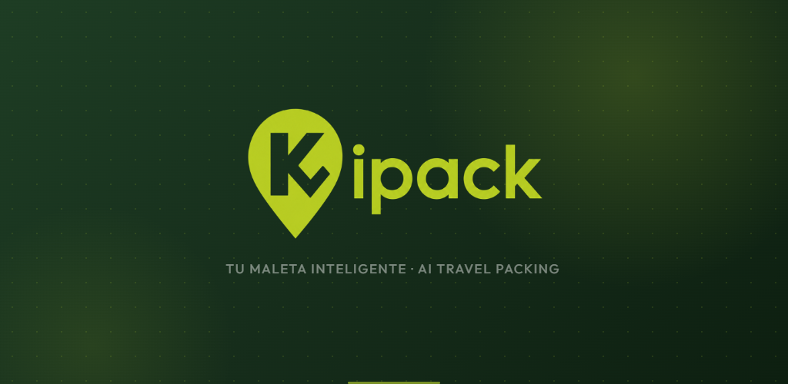

<div align="center">



# Kipack

**Tu maleta, lista en segundos.**
Listas de equipaje inteligentes generadas con IA para cada viaje.

[](https://play.google.com/store/apps/details?id=com.fooserd.kipack)
[](https://kipack-app.vercel.app)


</div>

---

## ✈️ ¿Qué es Kipack?

Kipack es una app móvil que te ayuda a preparar el equipaje sin olvidarte de nada. Le dices a dónde vas, cuántos días y qué vas a hacer, y la IA genera una lista personalizada teniendo en cuenta el destino, el clima previsto y tus actividades. Después puedes organizarla por maletas, marcar lo que ya has guardado y exportarla en PDF.

No hace falta crear una cuenta: todos tus viajes se guardan en el propio dispositivo.

## ✨ Funcionalidades

| | |
|---|---|
| 🤖 **Listas con IA** | Sugerencias según destino, duración, tipo de viaje y actividades concretas (buceo, senderismo, esquí…). Incluye un chat para pedir ajustes: *"llevo poco espacio, optimízala"*. |
| 🌦️ **Clima del viaje** | Previsión del destino con desglose día a día: temperaturas, probabilidad de lluvia y estado del cielo. |
| 🧳 **Varias maletas** | Reparte los artículos entre maletas y marca lo que ya está empacado. |
| 📋 **Plantillas** | Guarda listas reutilizables ("negocios", "playa"…) y aplícalas a cualquier viaje nuevo. |
| 🗺️ **Mapa de países** | Mapa mundial con los países visitados y los próximos destinos. |
| 🔔 **Recordatorios** | Avisos inteligentes: *"faltan 3 días y aún no has hecho la maleta"*. |
| 📄 **Exportar a PDF** | Genera un PDF de la lista por categorías y compártelo por WhatsApp, Drive o imprímelo. |
| 🚫 **Sin anuncios** | La app es gratuita con anuncios; un pago único en Google Play los quita para siempre. |
| 🌍 **Multidioma** | Español, inglés y francés. |

## 🛠️ Stack técnico

- **App:** Flutter / Dart con [Riverpod](https://riverpod.dev) para la gestión de estado; datos guardados en local (`shared_preferences`)
- **IA:** proxy propio en [Cloudflare Workers](https://workers.cloudflare.com) (`worker/`) que llama a modelos LLM vía [OpenRouter](https://openrouter.ai). La API key vive solo en el Worker como secreto, nunca en la app, y hay límite de peticiones por IP
- **Clima:** [Open-Meteo](https://open-meteo.com) (previsión, histórico y geocodificación)
- **Monetización:** Google AdMob (`google_mobile_ads`) y compra única para quitar anuncios con Google Play Billing (`in_app_purchase`)
- **Web:** página promocional y textos legales con [Astro](https://astro.build), desplegada en Vercel (`website/`)
- **Otros:** notificaciones locales, generación de PDF (`pdf` + `printing`), mapas (`countries_world_map`), i18n con ARB

## 📁 Estructura del proyecto

```
lib/
├── core/            # Lógica transversal: anuncios, billing, almacenamiento, tema, idioma…
├── features/        # Pantallas por funcionalidad
│   ├── trips/          # Viajes
│   ├── packing_list/   # Listas de equipaje, maletas y plantillas
│   ├── weather/        # Clima del destino
│   ├── map/            # Mapa de países
│   ├── settings/       # Ajustes
│   ├── onboarding/
│   └── legal/
├── l10n/            # Traducciones (es, en, fr)
└── main.dart
worker/              # Proxy de IA (Cloudflare Worker, TypeScript)
website/             # Web promocional (Astro)
```

## 🚀 Ejecutar en local

**Requisitos:** Flutter SDK (Dart ^3.12), Node.js y una cuenta de Cloudflare con una API key de OpenRouter.

```bash
git clone https://github.com/IamYisuSB/kipack.git
cd kipack
flutter pub get
```

**1. Despliega el proxy de IA** (solo la primera vez):

```bash
cd worker
npm install
npx wrangler secret put OPENROUTER_API_KEY   # tu API key de OpenRouter
npx wrangler secret put APP_TOKEN            # un token aleatorio que inventes
npx wrangler deploy
```

**2. Crea un archivo `.env`** en la raíz a partir de `.env.example`:

```env
KIPACK_AI_URL=https://<tu-worker>.workers.dev
KIPACK_AI_TOKEN=<el mismo valor que APP_TOKEN>
```

**3. Ejecuta la app:**

```bash
flutter run
```

## 👤 Autor

Desarrollado por **Jesús Guerrero** — [@IamYisuSB](https://github.com/IamYisuSB) · [Portfolio](https://jesus-guerrero-portfolio.vercel.app)

Desarrollado con la ayuda de [Claude Code](https://claude.com/claude-code).

---

<div align="center">

© 2026 Kipack · [Política de privacidad](https://kipack-app.vercel.app/privacidad) · [Términos](https://kipack-app.vercel.app/terminos) · [Borrar datos](https://kipack-app.vercel.app/borrar-datos)

</div>
